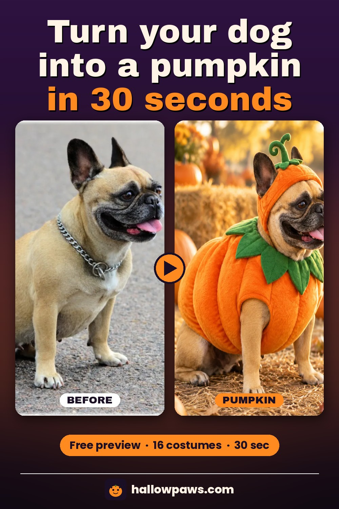
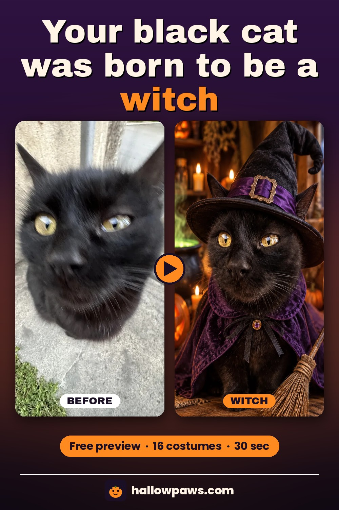

# HallowPaws · AI 宠物万圣节变装

**上传一张猫狗照片，选 16 款造型，约 30 秒出仍像你家毛孩子的高清万圣节写真。**

**Upload one dog or cat photo, pick a costume, get an HD Halloween portrait that still looks like *your* pet — in ~30 seconds.**

[🌐 Try free at hallowpaws.com](https://hallowpaws.com/?utm_source=github&utm_medium=readme&utm_campaign=hallowpaws_repo) · [中文站](https://hallowpaws.com/zh?utm_source=github&utm_medium=readme&utm_campaign=hallowpaws_repo)

---

## 一句话 / One-liner

HallowPaws 是面向铲屎官的 **AI 宠物万圣节服装写真生成器**：固定造型预设、尽量保留毛色花纹与五官，免写提示词；先免费水印预览，再按需买断高清包。

HallowPaws is an **AI pet Halloween costume generator** for dog & cat owners: fixed costume presets (no prompt writing), likeness-first results, free watermarked preview, then one-time HD packs — no subscription.

## 为什么做 HallowPaws

每年十月都有人给狗套南瓜服、给猫戴女巫帽——多数宠物不乐意，实体服装还贵。通用 AI 绘图要么不像自家那只，要么得自己写提示词。

HallowPaws 把流程压成三步：**上传一张清晰宠物照 → 选预设造型 → 下载写真**，提示词写死在每个造型里，优先「认得出是同一只动物」。

## Before / After 示例

站内示例由 Wikimedia **CC0** 宠物照片生成（非自家宠物），与线上同一套造型预设。完整对比见官网首页。

| Before → After · Pumpkin | Before → After · Witch |
|:-:|:-:|
|  |  |
| 法斗 → 南瓜装 | 黑猫 → 女巫 |

更多造型（吸血鬼、幽灵、恐龙、海盗等）与截图：见站点 [Before & after](https://hallowpaws.com/?utm_source=github&utm_medium=readme&utm_campaign=hallowpaws_repo#examples) 或本仓库 `assets/`。

## 功能

- **一张照片起步**：JPG / PNG / WebP，建议正脸或侧面清晰照（≤ 10MB）
- **16 款手调造型**：吸血鬼、女巫、南瓜、幽灵、骷髅、超级英雄、恐龙、海盗、魔法师、天使、小恶魔、蝙蝠、木乃伊、狼人、怪物实验室、Spooky Masked Stranger 等
- **认得出才算成功**：提示词模板锁定品种、毛色、花纹、眼睛；无自由 prompt 框
- **免费水印预览**：可先看效果；注册可获 **1 张无水印 HD**（以站点当前活动为准）
- **约 30 秒出图**：竖版 4:5，适合 Instagram / TikTok / 贺卡 / 壁纸
- **多宠合影**：Monster Party 包支持最多 3 只宠物同框
- **中英双语界面**

## 怎么用

1. 打开 [hallowpaws.com](https://hallowpaws.com/?utm_source=github&utm_medium=readme&utm_campaign=hallowpaws_repo)
2. 上传一张猫或狗的照片
3. 选择造型 → 生成预览
4. 喜欢再解锁高清下载

## 定价（一次性买断，不订阅）

1 积分 = 1 张高清图。生成失败不扣费。Stripe 结账。

| 套餐 | 额度 | 价格 | 说明 |
|---|---|---|---|
| Treat 尝鲜包 | 4 HD | **$1.99** | 8 款经典造型 |
| Spooky 惊魂包 ⭐ | 15 HD | **$4.99** | 全部 16 款造型 |
| Monster Party | 40 HD | **$9.99** | 全部造型 + 多宠合影（最多 3 只） |

## 技术栈（公开说明）

| 层 | 选型 |
|---|---|
| 前端 / 全栈 | TanStack Start（React） |
| 托管 | Cloudflare Workers |
| 数据 | Cloudflare D1 |
| 支付 | Stripe（一次性付款） |
| 图像 API | tryallapi（生产默认 GPT Image 系 edits，带 fallback） |
| 鉴权 | better-auth（邮箱等） |

> 本仓库是 **产品介绍 / 展示仓**，不含完整应用源码。私有实现与部署细节不在此公开。

## 适合谁

- 想要万圣节宠物写真、又不想硬套实体服装的铲屎官
- 需要发朋友圈 / Instagram / TikTok / 贺卡的季节性内容
- 做宠物相关内容、需要批量变装样例的创作者

## FAQ

**Q：人和小孩的照片可以上传吗？**  
不可以。HallowPaws 仅限宠物；人像会被拒绝。

**Q：一定像我家那只吗？**  
这是第一优先级。请用光照好、脸部清晰的照片；若结果偏差大，可换图重试。失败生成不扣费。

**Q：有订阅吗？积分会过期吗？**  
无订阅、无自动续费。买断积分在服务运营期间有效（以站点条款为准）。

---

## English

**HallowPaws** turns one pet photo into a recognizable Halloween costume portrait.

- **Upload** a clear dog or cat photo
- **Pick** one of 16 fixed costumes (vampire, witch, pumpkin, ghost, dino, pirate, wizard…)
- **Download** a free watermarked preview first; unlock HD with one-time packs from **$1.99**
- Sign-up includes **1 free HD** credit (subject to current site offer)
- Stack: TanStack Start · Cloudflare Workers / D1 · Stripe · tryallapi image models

### Before / after

Examples on the site (and the images in `assets/`) were generated from **CC0** Wikimedia pet photos with the same presets you get in the product. They illustrate likeness + costume style — not “real costumes on stressed animals.”

### Pricing (one-time)

| Pack | Credits | Price |
|---|---|---|
| Treat | 4 HD | $1.99 |
| Spooky | 15 HD (all 16 costumes) | $4.99 |
| Monster Party | 40 HD + multi-pet (up to 3) | $9.99 |

👉 Try it: **[hallowpaws.com](https://hallowpaws.com/?utm_source=github&utm_medium=readme&utm_campaign=hallowpaws_repo)**

---

## Disclaimer

- **Independent product.** HallowPaws is an indie project. It is **not** affiliated with, endorsed by, or sponsored by any pet brand, costume retailer, social network, or AI model provider.
- **AI-generated images.** Outputs are synthetic. Use responsibly; do not present them as real costume photos without disclosure where required.
- **Pets only.** Do not upload photos of people or children.
- **This GitHub repo** is a public overview + sample media. It is **not** the full application source code.

---

如果 HallowPaws 帮你家毛孩子过了个开心的万圣节，欢迎点个 ⭐ Star！

If HallowPaws made Halloween easier for your pet, a ⭐ would mean a lot.

